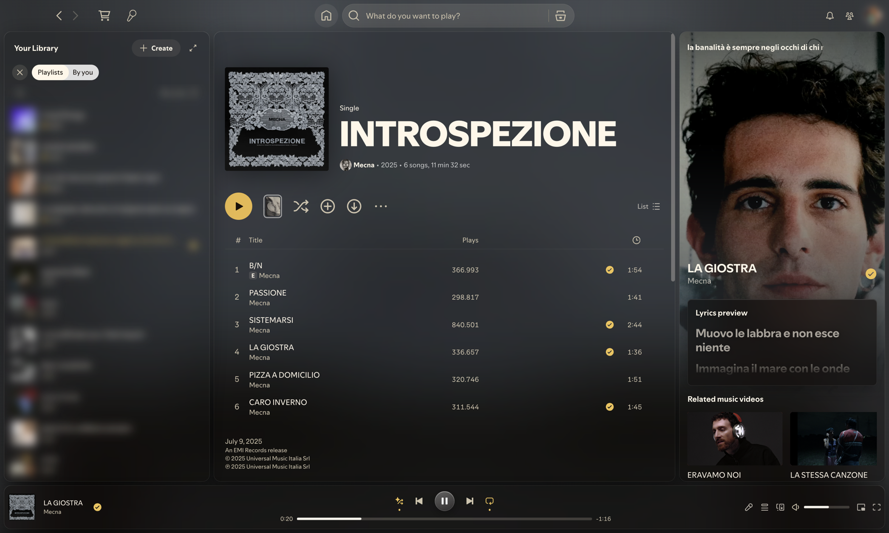

# Glassy

iOS-style frosted glass for Spotify. The whole app sits on a blurred copy of the cover of the song
that's playing. The background crossfades on every song change and dims itself on bright covers so
text stays readable.



## Features

- Translucent, blurred panels with a soft border and top highlight
- Dynamic background from the current cover art, with an automatic contrast dim
- Page headers follow the song's glass instead of each playlist's own colour
- Frosted top bar and sticky track-list header that blur what scrolls under them
- iOS-style glass play/pause button and slim progress and volume bars
- Smoked-glass lyrics card with clear active, upcoming and past line contrast
- Glass context menus and popovers

## Install

### Marketplace

Search for **Glassy** in the Marketplace **Themes** tab and click **Install**.

### Manual

```sh
cd "$(dirname "$(spicetify -c)")/Themes"
git clone https://github.com/blavkice/spicetify-glassy Glassy
spicetify config current_theme Glassy color_scheme Glassy inject_css 1 replace_colors 1 inject_theme_js 1
spicetify apply
```

`inject_theme_js` is required: `theme.js` draws the blurred cover-art background.

## Compatibility

Tested on Spotify **1.3.6** with Spicetify **2.46**. Most rules use stable hooks (ids, `data-testid`,
Spotify's design tokens), but a few rules target Spotify's hashed class names. If a Spotify update
renames them, some page-header colour fades may come back. Please open an issue with a screenshot.

## Uninstall

```sh
spicetify config current_theme marketplace   # or any other theme
spicetify apply
```
